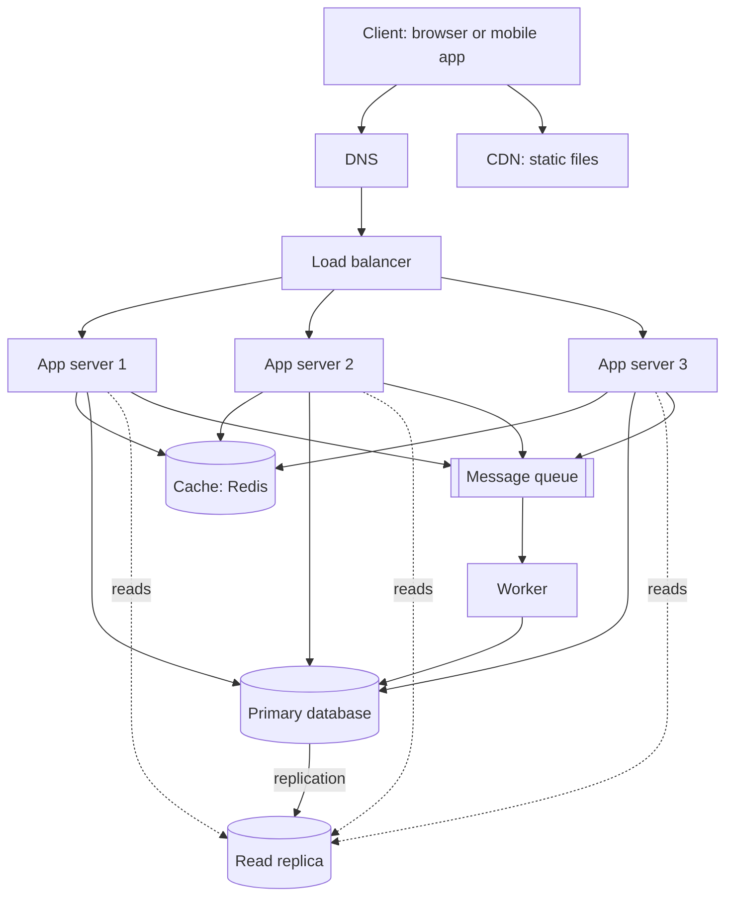

# QuickNotes Architecture

## Requirements

### Functional
- Users can sign up and log in.
- Users can create, view, edit and delete their own notes.
- Users can add tags to notes and filter notes by tag.
- The note list loads quickly and shows the newest notes first.

### Non-functional
- **Availability:** the app stays up even if one server or one data centre component fails (target 99.9%).
- **Latency:** listing notes answers in under 200 ms for most users.
- **Scalability:** it must grow to 1 million users without a redesign.
- **Durability:** a saved note is never lost.
- **Security:** users can only see their own notes, and all traffic uses HTTPS.
- **Consistency:** a user sees their own new note right after saving it. Slightly stale data elsewhere is acceptable.

## Load estimate for 1 million users

Assumptions: all 1,000,000 users are active each day, each opens or refreshes the note list 20 times a day, and each creates 2 notes a day. A note takes about 1 KB. One day has 86,400 seconds. Peak traffic is about 5 times the average.

| Item | Calculation | Result |
|------|-------------|--------|
| Reads per day | 1,000,000 x 20 | 20,000,000 |
| Reads per second (average) | 20,000,000 / 86,400 | about 231 |
| Reads per second (peak) | 231 x 5 | about 1,150 |
| Writes per day | 1,000,000 x 2 | 2,000,000 |
| Writes per second (average) | 2,000,000 / 86,400 | about 23 |
| Writes per second (peak) | 23 x 5 | about 115 |
| Storage per year | 2,000,000 x 365 x 1 KB | about 730 GB (roughly 1.5 TB with indexes) |

The app is read heavy, about 10 reads for every write, so caching and read replicas pay off. The numbers are small enough that this design has plenty of room to grow.

## Architecture diagram

## Components

- **Client:** the web page or mobile app where the user reads and writes notes.
- **DNS:** turns `quicknotes.example` into the address of the load balancer so users can find the service.
- **CDN:** serves the HTML, CSS and JavaScript from servers close to the user so pages load fast and our servers carry less traffic.
- **Load balancer:** spreads incoming requests across the app servers and stops sending traffic to any server that fails its health check.
- **App servers (three, stateless):** run the API code, check the login token and talk to the cache, database and queue.
- **Cache (Redis):** keeps each user's recent note list in memory so most reads never touch the database.
- **Primary database (PostgreSQL):** the single place where all writes go, so the data stays consistent.
- **Read replica:** a live copy of the primary that answers read queries and takes load off the primary.
- **Message queue:** holds slow background jobs so the user does not have to wait for them.
- **Worker:** takes jobs from the queue, such as search indexing, welcome emails and cleanup, and does them in the background.

## Request flows

### GET /notes
1. The client sends `GET /notes` with its token. DNS gives the address of the load balancer.
2. The load balancer picks a healthy app server.
3. The app server checks the token to find the user.
4. It looks in the cache for that user's note list.
5. On a cache hit, it returns the list straight away.
6. On a cache miss, it runs the query on the read replica, stores the result in the cache for a few minutes, and returns it.
7. The client shows the notes.

### POST /notes
1. The client sends `POST /notes` with the title and body.
2. The load balancer sends it to an app server.
3. The app server checks the token and validates the input (title required, up to 100 characters).
4. It writes the note to the primary database.
5. It deletes that user's cached note list, so the next read is fresh.
6. It puts a job on the queue (for example, "index this note for search") and replies `201 Created` right away.
7. A worker picks up the job later and finishes it in the background. The primary database copies the new note to the read replica.

## Trade-offs

1. **Cache speed against freshness.** The cache makes reads very fast, but it can hold old data. To limit this, a write removes the user's cached list, and entries expire after a few minutes anyway. The cost is extra code and one more thing to run.
2. **Read replica lag.** Reading from a replica spreads the load, but the copy can be a fraction of a second behind. Right after a user saves a note, reading from the replica might not show it. The fix is to read from the primary for a short time after that user writes, accepting slightly more load on the primary.
3. **Queue against simplicity.** Doing slow work in a worker keeps the API fast, but it adds a queue to operate, and jobs can run twice, so workers must be safe to repeat. For tiny apps, doing everything in the request would be simpler.

## Avoiding single points of failure

- **App servers:** at least three behind the load balancer, so losing one only reduces capacity.
- **Load balancer:** run a pair (active and standby, or a managed cloud load balancer that is already redundant).
- **DNS and CDN:** use providers that run in many locations.
- **Database:** the read replica can be promoted to primary if the primary fails, and backups are taken every day.
- **Cache:** if Redis goes down, the app falls back to the database for a while (slower, but still working). A replicated cache avoids even that.
- **Queue and workers:** the queue stores jobs on disk, and several workers run at once, so one dying does not lose work.
